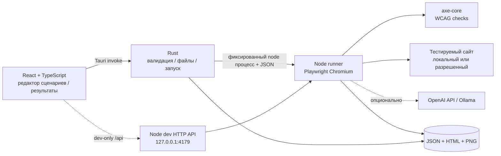

# Архитектура UXProof v0.1

## 1. Компоненты



**Цель выбора стека:** ядро desktop/FS/process в Rust, автоматизацию Chromium не переписываем с нуля, а используем существующую стабильную экосистему Playwright. Этот подход быстрее довести до работающего конкурса, чем создавать Rust WebDriver-движок.

## 2. Runtime-режимы

| Режим | Команда UI | Оркестратор | Где результаты |
|---|---|---|---|
| Web development | `npm run dev` | Node HTTP API на localhost | `<repo>/.uxproof-data/runs/` |
| Tauri development | `npm run tauri dev` | Rust IPC через `run_audit` | OS app data path для `dev.uxproof.desktop/runs/` |
| Packaged Windows | `npm run tauri build` | Rust IPC (исходники) | App data, **не проверено** |

Примечание: первый режим нужен для быстрого исследования UX без установки компилятора Rust; архитектурно desktop-приложение всё равно вызывает Rust напрямую. `npm run dev` не имитирует тесты: и в браузере, и в Tauri используется **один и тот же** `runner/audit.mjs`.

## 3. Слои

### `src/`

- `lib/types.ts`: контракт между UI, Rust и Node.
- `lib/presets.ts`: 3 готовых сценария и 3 разрешения.
- `lib/bridge.ts`: Tauri IPC либо local API dev adapter.
- `App.tsx`: состояния, выбор сценариев, редактор, история, журнал дефектов, просмотр PNG.
- `styles.css`: локальные стили без подключения внешних CDN.

### `src-tauri/`

- `run_audit(config)`: схема и ограничения конфигурации, UUID, каталог хранения, передача конфигурации в stdin процесса `node runner/cli.mjs`, JSON-ответ. Старые каталоги могут содержать ранее записанный `input.json`.
- `list_reports()`: чтение последних 30 отчётов.
- `read_screenshot(runId,filename)`: PNG строго из `screenshots/` каталога run.
- `export_html(runId)`: возврат локального пути к созданному HTML.
- `capabilities/default.json`: минимальные core разрешения, без frontend shell/fs.

### `runner/`

- `validators.mjs`: URL, limits, типы действий, Playwright locator factory.
- `audit.mjs`: изоляция browser context, выполнение шагов, axe, pageerror, overflow, скриншот, сводка.
- `ai.mjs`: vision review OpenAI или Ollama; JSON с тремя рекомендациями максимум.
- `html.mjs`: самостоятельный HTML-отчёт, экранирование пользовательского текста.
- `cli.mjs`: вход/выход по JSON для Rust.
- `dev-server.mjs`: локальный HTTP API для web dev preview.

### `demo/`

- `server.mjs`: локальный static server 127.0.0.1:4180.
- `index.html`: специальное тестовое приложение Relay, где есть два намеренных UX-дефекта.

## 4. Sequence of operations

```text
UI: клик "Запустить аудит"
 -> validate config (Rust / Node dev)
 -> make runId, outputDir
 -> Playwright chromium.launch
 -> for each Scenario × Viewport:
      browser.newContext({ viewport })
      page.goto(baseUrl)
      for step in scenario.steps:
        выполнить действие
        при ошибке: записать failed, остановить сценарий
      AxeBuilder(page).analyze()
      measure document scrollWidth vs viewport
      gather pageerror
      page.screenshot(screenshots/....png) с маской полей, iframe, canvas и видео
      optionally reviewScreenshot() (max 1 per scenario, max 3 calls)
      context.close()
 -> summary, report.json, report.html
 -> report to UI
 -> history available on disk
```

**Не сохраняем:** произвольные cookies, HAR, видеозаписи, полные DOM snapshots — это отложено во избежание лишней сложности и риска утечки данных. Маска снимка не распознаёт личные данные в обычном видимом тексте, именах шагов или сообщениях сайта; это остаётся ограничением приватности.

## 5. Доверенная классификация

| Тип | Класс | Основание | Доказательство |
|---|---|---|---|
| `functional` | `confirmed` | Playwright step threw | Ошибочный шаг, locator, скриншот |
| `javascript` | `confirmed` | pageerror браузера | Текст исключения, скриншот |
| `accessibility` | `confirmed` | Нарушение, найденное axe | Rule ID, target selectors, helpUrl, PNG |
| `overflow` | `confirmed` | `scrollWidth > innerWidth + 3` | Измеренные размеры, PNG |
| `ai-ux` | `recommendation` | Мультимодальная модель | Скриншот и формулировка гипотезы |

`confirmed` означает подтверждение **исполнителем своего узкого правила**, но не всеобъемлющую гарантию корректности. Например, axe rule может потребовать ручной интерпретации, а horizontal overflow не обязательно всегда является дефектом бизнес-сценария.

## 6. Доказательства и воспроизведение

Каждое функциональное предупреждение содержит имя сценария, ошибочный шаг, текст ошибки Playwright и цепочку шагов. PNG фиксирует конечное состояние после падения или окончания сценария. В v0.1 не делается снимок каждого шага: расследование сложных случаев может потребовать отдельного запуска с trace. Это будущая задача.

## 7. Threat model (сокращенно)

| Риск | Сейчас | Следующая итерация |
|---|---|---|
| LLM prompt injection в интерфейсе | Текст страницы не исполняется, LLM инструкции из скриншота игнорируются в системном промпте, но возможна модельная ошибка | Уплотнение границы, отсутствие LLM execution и ручная модерация |
| Злоупотребление файловой системой | Rust не даёт frontend произвольных FS команд, file-name whitelist | Реализация private storage и cryptographic signatures |
| Случайные покупки/удаление | Выполняем указанные клики, нет запрета | Whitelist actions, dry-run, snapshot environments |
| Непреднамеренные запросы к внутренним сайтам | Базовый URL может быть loopback или явно указанным адресом. Метадата, link-local и чужие частные адреса блокируются; переход сценария ограничен origin проекта | Сетевой allowlist доменов |
| Утечка скриншота в LLM | ИИ выключен по умолчанию, выбор провайдера отображается | Redaction/PII scrubber |
| Node и Chromium в поставке | Не bundled | Сборка Windows sidecar + Chromium + code signing |

## 8. Решения, которые стоит принять для v0.2

- Способ упаковки Node/Playwright (Tauri sidecar либо отдельный запакованный runner).
- Схема создания тестового аккаунта и auth state.
- Recorder с возможностью ручной очистки личных данных.
- Стабильная система ID проблем для регрессий (а не порядковая нумерация в каждом прогоне).
- CI runner в отдельном процессе/контейнере.
