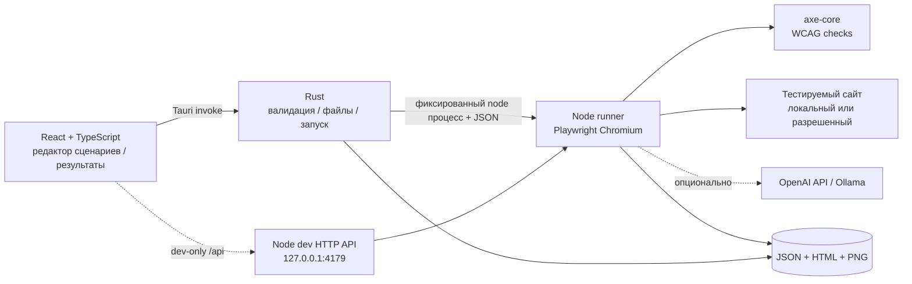

# Архитектура UXProof v0.1

## 1. Компоненты



**Цель выбора стека:** ядро desktop/FS/process в Rust, автоматизацию Chromium не переписываем с нуля, а используем существующую стабильную экосистему Playwright. Этот подход быстрее довести до работающего конкурса, чем создавать Rust WebDriver-движок.

## 2. Runtime-режимы

| Режим | Команда UI | Оркестратор | Где результаты |
|---|---|---|---|
| Web development | `npm run dev` | Node HTTP API на localhost | `<repo>/.uxproof-data/runs/` |
| Tauri development | `npm run tauri dev` | Rust IPC через `run_audit` | OS app data path для `dev.uxproof.desktop/runs/` |
| Packaged Windows | `npm run tauri build` | Rust IPC, встроенные Node 24 и Chromium | `%APPDATA%\dev.uxproof.desktop\runs\` (проверено в release-окне и на `mono`) |

Примечание: первый режим нужен для быстрого исследования UX без установки компилятора Rust; архитектурно desktop-приложение всё равно вызывает Rust напрямую. `npm run dev` не имитирует тесты: и в браузере, и в Tauri используется **один и тот же** `runner/audit.mjs`.

## 3. Слои

### `src/`

- `lib/types.ts`: контракт между UI, Rust и Node.
- `lib/presets.ts`: 3 готовых сценария и 3 разрешения.
- `lib/bridge.ts`: Tauri IPC либо local API dev adapter.
- `lib/format.tsx`, `lib/report-view.ts`: отображение отчёта.
- `components/ReportSection.tsx`: сводка, дефекты, прогоны, экспорт.
- `App.tsx`: состояния, выбор сценариев, редактор, история, журнал дефектов, просмотр PNG.
- `styles.css`: локальные стили без подключения внешних CDN.

### `src-tauri/`

- `lib.rs`: lock прогона, точка входа, `kill_running_audit` на Exit.
- `url.rs`: проверка конфигурации и URL до spawn.
- `commands.rs`: IPC `run_audit`, `cancel_audit`, `list_reports`, `export_*`, `plan_steps`. Конфиг уходит в stdin `node runner/cli.mjs`.
- `spawn.rs`: выбор bundled Node/Chromium в release, `plain_path` (без `\\?\`), `UXPROOF_LOCK_HELD`, Windows Job Object `KILL_ON_JOB_CLOSE` (BUG-028).
- Debug берёт runner из checkout; release — из ресурсов пакета. Список файлов задан явно в `tauri.conf.json`.
- `capabilities/default.json`: минимальные core разрешения, без frontend shell/fs.

### `runner/`

- `validators.mjs`: URL, limits, типы действий, Playwright locator factory.
- `audit.mjs` + `audit-control.mjs` + `audit-finalize.mjs`: изоляция context, шаги, axe, pageerror, overflow, скриншот, сводка.
- `detectors.mjs` и `rules/registry-v0.1.json`: layout/copy правила.
- `ai.mjs`: vision review OpenAI или Ollama; не больше трёх рекомендаций.
- `planner.mjs`: черновик шагов по тексту, тот же `validateConfig`.
- `xlsx.mjs` / `export-xlsx.mjs`: `report.xlsx`.
- `mcp-server.mjs`: stdio MCP поверх dev API.
- `html.mjs`: самостоятельный HTML-отчёт, экранирование пользовательского текста.
- `cli.mjs`: вход/выход по JSON для Rust.
- `dev-server.mjs`: локальный HTTP API для web dev preview.

### `demo/`

- `server.mjs`: локальный static server 127.0.0.1:4180 (в т.ч. `/fixed`).
- `index.html`: Relay с намеренными UX-дефектами (нет status при сохранении, скрытая «На главную» на узком экране, JS-исключение в настройках, overflow).

## 4. Sequence of operations

```text
UI: клик "Запустить аудит"
 -> validate config (Rust / Node dev)
 -> make runId, outputDir
 -> local authenticated guard proxy (DNS validation and pinned destination IPs)
 -> Playwright chromium.launch (proxy for HTTP(S), QUIC disabled)
 -> for each Scenario × Viewport:
      browser.newContext({ viewport })
      page.goto(baseUrl)
      for step in scenario.steps:
        записать before/action
        выполнить действие
        записать after или при ошибке: сохранить отдельный PNG, записать error, остановить сценарий
      AxeBuilder(page).analyze()
      measure document scrollWidth vs viewport
      gather pageerror
      page.screenshot(screenshots/....png) с маской полей, iframe, canvas и видео
      optionally reviewScreenshot() (max 1 per scenario, max 3 calls)
      context.close()
 -> summary, report.json, report.html, artifacts.json (относительные пути и SHA-256)
 -> report to UI
 -> history available on disk
```

**Не сохраняем:** произвольные cookies, HAR, видеозаписи, полные DOM snapshots — это отложено во избежание лишней сложности и риска утечки данных. Маска снимка не распознаёт личные данные в обычном видимом тексте, именах шагов или сообщениях сайта; это остаётся ограничением приватности.

Прокси проверяет назначения HTTP и CONNECT, включая redirect; разрешённые DNS-адреса передаются непосредственно соединению. Он не является полноценным сетевым sandbox ОС. Лимит в 10 000 считает рукопожатия прокси (HTTP-запросы и CONNECT/upgrade), а не запросы внутри HTTPS-туннеля. Байты CONNECT и WebSocket режутся потолком туннеля. Переход основного окна на другой origin для перехваченной навигации блокируется до запроса; HTTP redirect по-прежнему может выполниться на первом hop. Второе окно/popup закрывается и его запросы обрываются. Полная изоляция ОС не обещается.

Один файловый замок `.audit.lock` в каталоге `runs` (с PID владельца) делят CLI, dev API и Tauri. Desktop держит lock на весь IPC-вызов и передаёт sidecar `UXPROOF_LOCK_HELD=1`, иначе CLI берёт тот же файл повторно (BUG-026). Отмена в UI: в dev — кооперативный AbortSignal без SIGINT на процесс API; в Tauri — `taskkill /T` по PID. Закрытие окна убивает дерево через Job Object. Поздний JSON после «Остановить» интерфейс отбрасывает.

## 5. Доверенная классификация

| Тип | Класс | Основание | Доказательство |
|---|---|---|---|
| `functional` | `confirmed` | Playwright step threw | Ошибочный шаг, locator, скриншот |
| `javascript` | `confirmed` | pageerror браузера | Текст исключения, скриншот |
| `accessibility` | `confirmed` | Нарушение, найденное axe | Rule ID, target selectors, helpUrl, PNG |
| `overflow` | `confirmed` | `scrollWidth > innerWidth + 3` | Измеренные размеры, PNG |
| `ai-ux` | `recommendation` | Мультимодальная модель | Скриншот и формулировка гипотезы |

`confirmed` означает подтверждение **исполнителем своего узкого правила**, но не всеобъемлющую гарантию корректности. Например, axe rule может потребовать ручной интерпретации, а horizontal overflow не обязательно всегда является дефектом бизнес-сценария.

## 6. Доказательства и воспроизведение

Каждое функциональное предупреждение содержит имя сценария, ошибочный шаг, текст ошибки Playwright и цепочку шагов. Для ошибки шага создаётся отдельный PNG до дополнительных проверок; конечный PNG прогона хранится отдельно. По желанию `trace: on-failure` пишет ZIP только для упавшего сценария (может содержать DOM и сеть).

## 7. Threat model (сокращенно)

| Риск | Сейчас | Следующая итерация |
|---|---|---|
| LLM prompt injection в интерфейсе | Текст страницы не исполняется, LLM инструкции из скриншота игнорируются в системном промпте, но возможна модельная ошибка | Уплотнение границы, отсутствие LLM execution и ручная модерация |
| Злоупотребление файловой системой | Rust не даёт frontend произвольных FS команд, file-name whitelist | Реализация private storage и cryptographic signatures |
| Случайные покупки/удаление | Выполняем указанные клики, нет запрета | Whitelist actions, dry-run, snapshot environments |
| Непреднамеренные запросы к внутренним сайтам | Базовый URL может быть loopback или явно указанным адресом. Метадата, link-local и чужие частные адреса блокируются; переход сценария ограничен origin проекта | Сетевой allowlist доменов |
| Утечка скриншота в LLM | ИИ выключен по умолчанию, выбор провайдера отображается | Redaction/PII scrubber |
| Node и Chromium в поставке | Windows x64 MSI/NSIS: Node 24.14.1 и Chromium Headless Shell 1255, SHA-256 манифест | Подпись установщика, вложенные джобы под отладчиком |

## 8. Решения, которые стоит принять для v0.2

- Подпись MSI/NSIS и прогон установщика на образе без WebView2.
- Схема тестового аккаунта и auth state.
- Recorder с ручной очисткой личных данных.
- Более устойчивые семантические якоря (сейчас ID строится из rule + якорь; смена сценария меняет fingerprint шага).
- Первый hop HTTP-redirect без MITM и fuzzy UX-регрессии.
